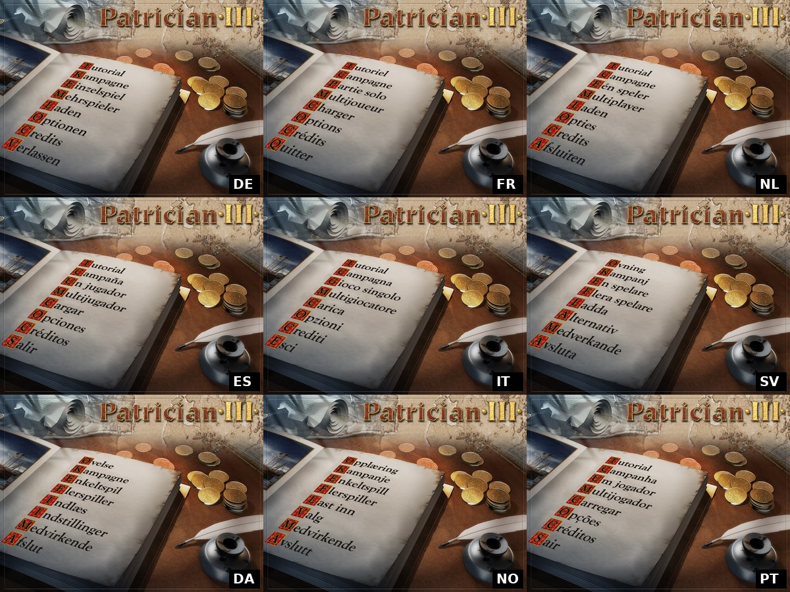

# Patrician III Localization

Play **Patrician III** (GOG and Steam) in your own language. This mod replaces the English game texts with translations: menus, trade goods, letters, chronicle and event messages, guild and Hanseatic League dialogues, missions, the campaign list, the tutorial, the credits, the names of towns, guilds, taverns and ships, and the pictures of the main menu. It is loaded by the [P3Modding modloader](https://p3modding.github.io/modloader.html) and also translates selected texts of the official mods.

**Version 0.5.0** · Tested with GOG, Steam and P3Modding 0.1.15

## Available languages

| Language | Code | Game texts (menus, goods, events, letters) | Missions and campaigns | Tutorial, credits, names | Main menu |
|---|---|---|---|---|---|
| Deutsch | `de` | complete | translated | translated | translated |
| Français | `fr` | complete, not proofread | translated, not proofread | translated, not proofread | translated |
| Nederlands | `nl` | complete, not proofread | translated, not proofread | translated, not proofread | translated |
| Español | `es` | complete, not proofread | translated, not proofread | translated, not proofread | translated |
| Italiano | `it` | complete, not proofread | translated, not proofread | translated, not proofread | translated |
| Svenska | `sv` | complete, not proofread | translated, not proofread | translated, not proofread | translated |
| Dansk | `da` | complete, not proofread | translated, not proofread | translated, not proofread | translated |
| Norsk (Bokmål) | `no` | complete, not proofread | translated, not proofread | translated, not proofread | translated |
| Português | `pt` | complete, not proofread | translated, not proofread | translated, not proofread | translated |

"Not proofread" means: every text is translated, but no native speaker has reviewed it yet. Some sentences, which the game assembles from several pieces, can read a little awkwardly. Corrections are very welcome, see [docs/LANGUAGES.md](docs/LANGUAGES.md).

> **Known limitation - missing font characters.** The game font has no glyphs for `å æ ø ñ ç ã õ ë ï œ`, `¡ ¿ « »` and capital accented letters, so these are replaced by plain letters in the translations (for example Swedish `Rådhus` is shown as `Radhus`, Danish/Norwegian `å` as `aa`). Proper characters need a patched game font. Details and the full substitution table: [docs/LANGUAGES.md](docs/LANGUAGES.md#character-set).

## Installation

You need two things besides this mod: the game itself and the modloader.

1. Install Patrician III from GOG or Steam.
2. Download the [P3Modding modloader](https://p3modding.github.io/modloader.html) and copy `p3_modloader.dll` and `Patrician3_modloader.exe` into the game folder (the folder that contains the game's `.exe`).
3. From the [Releases](../../releases) page, download **`patrician3-localization-<version>.zip`** and extract it into the game folder. This creates two files in the `mods` folder: `patrician3_localization.dll` and `localization.ini`.
4. Open `mods\localization.ini` with Notepad and set your language code, for example `language=fr` for French. Without this file the mod uses German.
5. Nothing else to download: the zip also holds the main menu pictures of every language (`mods\localization\<code>\`), and the mod shows those of the language set in `localization.ini`.
6. Start the game with `Patrician3_modloader.exe`.

Optional: further mods from [P3Moddings `mods.zip`](https://github.com/P3Modding/p3-lib/releases/tag/0.1.15) go into the same `mods` folder. Their texts are translated as well, as far as the mod knows them.

### Step-by-step guide in your language

[Deutsch](docs/install/de.md) · [Français](docs/install/fr.md) · [Nederlands](docs/install/nl.md) · [Español](docs/install/es.md) · [Italiano](docs/install/it.md) · [Svenska](docs/install/sv.md) · [Dansk](docs/install/da.md) · [Norsk](docs/install/no.md) · [Português](docs/install/pt.md)

### Updating from the old German mod

Earlier versions were called "Deutschmod" and shipped as `german_localization.dll`. **Delete `mods\german_localization.dll` first.** Two copies of the mod would patch the same texts and conflict. Then install as described above.

### Something went wrong?

- **The game is still English.** Check that `localization.ini` is in the `mods` folder and that you started the game with `Patrician3_modloader.exe`.
- **An error message appears at start and lists the available languages.** The language code in `localization.ini` is misspelled. Use one of: `de`, `fr`, `nl`, `es`, `it`, `sv`, `da`, `no`, `pt`.
- **The main menu shows another language, or its highlight is cut up.** Loose files from the German resources zip of earlier versions override the mod. Delete `images\Options\Hauptmenu.jpg`, `p_hmenu01.bmp`, `hmenu_colormap.bmp` and `scripts\textures.ini` in the game folder (and `maps\Standard24.gmf`, `missions` and `missions_addon` if an older zip added them), or reinstall the game files.

## Screenshots




## How it works

The English game executable was analysed with REA and Ghidra to find texts, text pointers and how they are used. For German wording, the original texts of **Patrizier II Gold** served as one reference. The assignments were checked in their context; individual texts were adapted.

At startup the mod checks that the expected text addresses in the game match, then replaces the text pointers in memory. This keeps different translations of the same English word in their respective places. One text hook translates composed texts and labels of other mods. Guild and event messages are built from translated sentence parts such as articles, adjectives and ranks. A second hook takes the longer text of some languages into account for tooltips. A third hook sits in `archiver.dll`, through which the game and its renderer read every file of the archive: game files with texts (missions, map, campaign list, tutorial, credits, name lists) get the texts of the configured language, the main menu pictures are replaced by those of the language and `textures.ini` gets the matching sprite rectangles; files that do not match the English originals stay untouched. The hook checks the first bytes of every function it diverts and leaves the archive alone if they differ. All translation tables are embedded into the DLL.

## For developers

Rust and the Windows target `i686-pc-windows-msvc` are required. In the project folder:

```powershell
rustup target add i686-pc-windows-msvc
cargo build --locked --release --target i686-pc-windows-msvc
```

The DLL is created at `target/i686-pc-windows-msvc/release/patrician3_localization.dll` and belongs in the game at `mods/patrician3_localization.dll`.

`powershell -File tools\package.ps1` builds the release archive into `dist\`.

```text
patrician3-localization/
├── Cargo.toml
├── Cargo.lock
├── README.md
├── LICENSE                 Apache License 2.0
├── src/                    mod code and tests
├── data/                   translation tables, embedded into the DLL at build time
│   ├── german_localization.tsv
│   ├── render_translations.tsv
│   ├── extra_slots.tsv
│   ├── files/              texts of the game files, one table per language, source.tsv = English
│   ├── glossary/           town names per language
│   ├── lang/               one table per additional language
│   └── gfx/                main menu pictures per language (not embedded; mods\localization\<code>\)
├── tools/                  packaging script, sample localization.ini, textkit/ (extraction, glossary),
│                           gfx/ (main menu picture generator)
└── docs/                   language documentation, install guides, screenshots
```

Checks:

```powershell
cargo fmt --all -- --check
cargo clippy --locked --target i686-pc-windows-msvc --all-targets -- -D warnings
cargo test --locked --target i686-pc-windows-msvc
```

## License

The mod code and our own contributions to the translation tables are licensed under the [Apache License 2.0](LICENSE). Game texts and the pictures under `data/gfx/` (made from the game's own pictures) are not covered by it; rights of third parties remain unaffected.

## Credits and origin

Thanks to **P3Modding** for the [modloader, tools and documentation](https://github.com/P3Modding/p3-lib) this mod builds on.

Special thanks to [**@Trolldemorted**](https://github.com/Trolldemorted) (Benedikt Radtke) for his outstanding reverse-engineering work.
